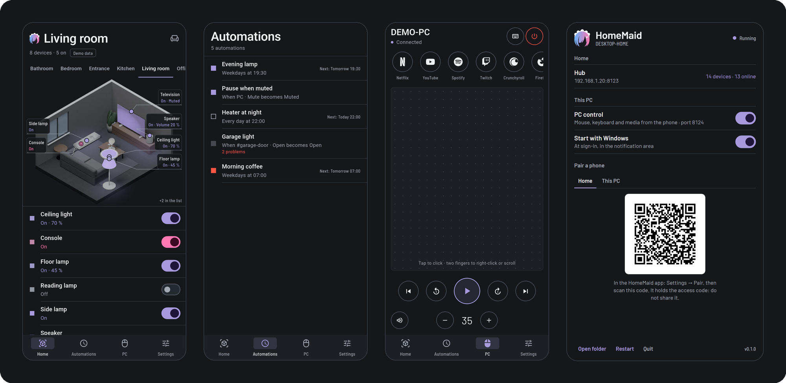
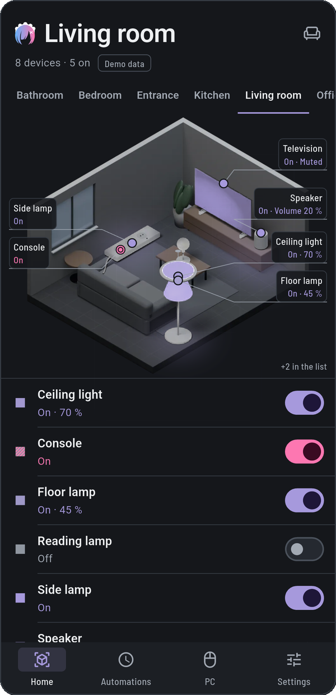
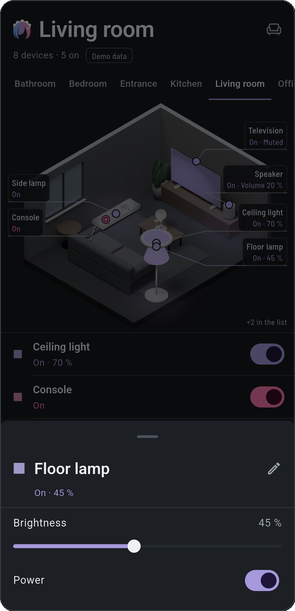
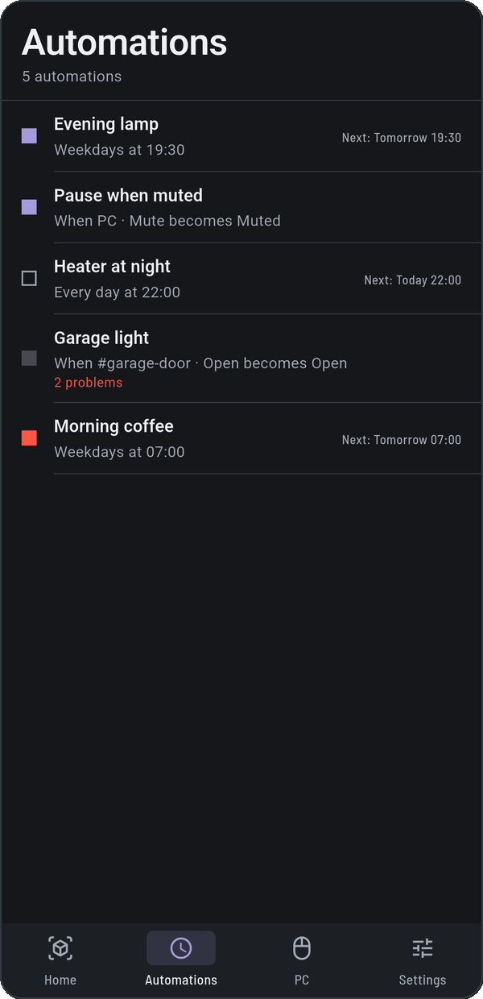
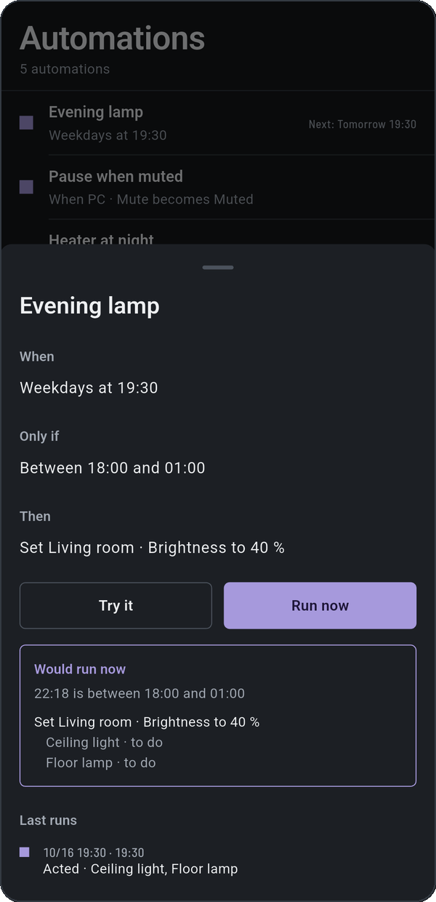
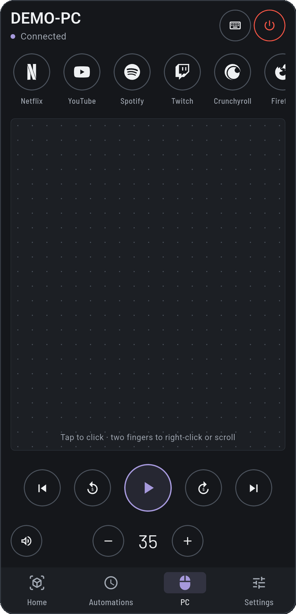
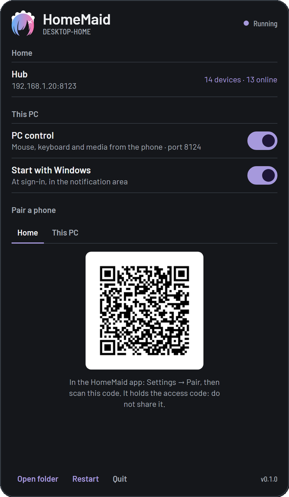
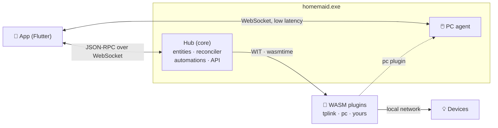

<div align="center">


# HomeMaid

**A home automation hub in Rust, in the spirit of Home Assistant.**<br>
Local-first, typed and sandboxed, with a phone app that shows your home as a live 3D model.

[](https://github.com/ErwanHeschung/HomeMaid/actions/workflows/ci.yml)


[](#license)



</div>

> [!NOTE]
> **HomeMaid is just getting started.** It is at a very early stage: expect missing features,
> rough edges and breaking changes (config format, API, plugin API before 2.0).
>
> **It is also a personal project.** I build HomeMaid for my own home, so only my own devices are
> officially supported (a TP-Link Tapo P300 power strip and my Windows PC). The architecture is
> meant to grow, though: devices come from plugins that anyone can write. **Feel free to fork it**
> and make it yours.

## Why another hub?

Home Assistant is amazing, and it carries many years of history. HomeMaid starts from scratch with
a few ideas that are hard to add later:

| Home Assistant | HomeMaid |
|---|---|
| State is a string, attributes a free-form dict | **Typed capabilities** with a schema: `on_off`, `brightness`, `power { watts }`, `volume`… |
| Commands are fire-and-forget | **Desired state vs observed state**, with a reconciler: every command is *pending*, *confirmed* or *failed*, and an offline device gets its desired state back when it returns |
| Renaming `light.salon` breaks automations | **Stable UUIDs** and **selectors** (`room:Salon & cap:on_off`) |
| YAML and Jinja templates, checked at run time | **Typed automations checked at load**, with a **dry run** ("what would it do right now?") |
| A buggy integration can take the core down | **WASM plugins** in a sandbox (memory and time limits, local network only), restarted on crash |
| Dashboards of tiles in a WebView | A **native Flutter app**: the home as a live CAD model, a PC remote with a trackpad |

## What it looks like

<table>
  <tr>
    <td width="33%"></td>
    <td width="33%"></td>
    <td width="33%"></td>
  </tr>
  <tr>
    <td><b>Each room is a furnished dollhouse.</b> Devices sit where they belong, lit in lavender when they are really on; drag to turn the room.</td>
    <td><b>Every device has a sheet</b> built from its capabilities: a new plugin shows up in the app without any app change.</td>
    <td><b>Automations read as sentences</b>, with their next run, their last runs and any problem.</td>
  </tr>
  <tr>
    <td></td>
    <td></td>
    <td></td>
  </tr>
  <tr>
    <td><b>Try it</b> runs an automation in dry mode: which conditions pass, which devices would change.</td>
    <td><b>The phone is a PC remote</b>: trackpad, keyboard, media keys, volume and your streaming services.</td>
    <td><b>On the PC</b>, HomeMaid lives in the notification area. Its window shows the QR codes to pair the phone.</td>
  </tr>
</table>

The colours follow one rule everywhere: **lavender** is on (always the state the device reported,
never a wish), **pink** is a command still waiting for the device, **red** is a failure.

## Features

- **Hub** (`core/`): entities and typed capabilities, desired/observed state with a reconciler,
  JSON-RPC 2.0 over WebSocket, declarative TOML config that the app edits without losing your
  comments, mDNS discovery.
- **Plugins** (`core/plugins/`): WebAssembly components (`wasm32-wasip2`) behind a versioned WIT
  interface, [`plugin-api`](core/plugin-api/wit/plugin.wit) v1.1. Official plugins use the same
  public API as third-party ones.
  - `tplink`: TP-Link Tapo P300 power strip, local KLAP v2 protocol, one entity per outlet.
  - `pc`: your PC as a device of the home (volume, mute, CPU, memory, active window) with one-shot
    actions (play/pause, next, lock, sleep, shut down, open a service).
- **Automations**: time and state triggers, conditions, actions on selectors, dry run, the last 20
  runs, a loop guard.
- **PC agent**: mouse, keyboard, media keys, volume (Core Audio), power, streaming services
  ([Simple Icons](https://simpleicons.org) logos). Windows first.
- **PC client**: on Windows, double-click `homemaid.exe` and it runs the hub and the agent, with
  its logo in the notification area, a window to pair your phone and an option to start with
  Windows. No config to write: the first start creates it, tokens included.
- **App** (`app/`): Flutter, Android first. The home as pre-rendered Blender rooms and devices,
  composited live. A demo flavour with a synthetic home to try everything without a hub.

## Architecture



One binary, several roles, set by flags: `--core`, `--agent`, or both. On Windows without flags it
starts the PC client. The core runs anywhere Rust runs (Windows, Linux x86_64, ARM64), so it can
move to a Raspberry Pi or a mini-PC without code changes.

<details>
<summary><b>Repository layout</b></summary>

| Path | What |
|---|---|
| `core/crates/homemaid` | The server library: hub, agent, API, config, automations, plugin host |
| `core/crates/desktop` | The Windows PC client (notification area, WebView2 window) |
| `core/crates/bin` | The `homemaid` executable |
| `core/crates/caps` | Typed capabilities, shared with the plugin SDK |
| `core/plugin-api` | WIT interface and Rust SDK for plugins |
| `core/plugins` | Official plugins (`tplink`, `pc`) and the `mock` used by tests |
| `app` | The Flutter app |
| `DESIGN.md`, `PRODUCT.md` | Design system and product context |

</details>

## Getting started

### On a Windows PC (hub and remote)

1. Download the **HomeMaid-windows** artifact from the
   [latest CI run on `main`](https://github.com/ErwanHeschung/HomeMaid/actions/workflows/ci.yml?query=branch%3Amain)
   (signed in to GitHub) and unzip it, for example to `C:\HomeMaid`. The WebView2 runtime it uses
   comes with Windows 10 and 11.
2. Double-click `homemaid.exe`. Allow it on private networks when Windows asks (ports 8123 and 8124).
3. Install the app from the **HomeMaid-android** artifact (`app-real-release.apk`), then in the app:
   *Settings → Pair*, and scan the QR codes shown in the HomeMaid window.

The first start writes `homemaid.toml` next to the exe. See
[`homemaid.example.toml`](core/homemaid.example.toml) for every option: plugins, rooms, automations,
streaming services.

> [!TIP]
> Just curious? Install `app-demo-release.apk`: it runs a synthetic home covering every device and
> state, no hub needed.

### Build from source

```sh
# Hub, agent and plugins (Rust stable)
cd core
rustup target add wasm32-wasip2
cargo test
cargo build --release -p pc-plugin -p tplink-plugin --target wasm32-wasip2

# The Windows exe, cross-compiled from Linux or WSL
sudo apt install mingw-w64 && rustup target add x86_64-pc-windows-gnu
cargo build --release -p homemaid-bin --target x86_64-pc-windows-gnu

# A Linux server (a Pi, a mini-PC…): copy the example, set its tokens and plugin paths, run
cp homemaid.example.toml homemaid.toml
cargo run --release -p homemaid-bin -- --core --config homemaid.toml

# The app (Flutter)
cd ../app
flutter run --flavor demo --dart-define=HOMEMAID_DEMO=true
```

## Automations

Written in `homemaid.toml`, checked when the hub starts: a typo stops it with a message saying
where, instead of an automation that silently never runs.

```toml
[[automation]]
id = "evening-lamp"
name = "Evening lamp"

[[automation.trigger]]
at = "19:30"
days = ["mon", "tue", "wed", "thu", "fri"]

[[automation.condition]]
between = ["18:00", "23:30"]

[[automation.action]]
set = { select = "room:Salon & model:lamp", cap = "brightness", value = 40 }
```

## Writing a plugin

A plugin is a Rust crate compiled to `wasm32-wasip2` with the SDK in `core/plugin-api`. It
declares its entities and capabilities, applies desired states and reports what it observes; the
core does the rest (retries, pending/confirmed/failed, the UI).

```rust
use homemaid_plugin::{CapKind, CapMeta, CapValue, DiscoveredEntity, Manifest, Plugin, LOCAL_NETWORK, report_state};

struct Lamp;

impl Plugin for Lamp {
    fn manifest() -> Manifest {
        Manifest { id: "lamp".into(), version: "0.1.0".into(), permissions: vec![LOCAL_NETWORK.into()] }
    }
    fn init(_settings: std::collections::BTreeMap<String, String>) -> Result<(), String> { Ok(()) }
    fn discover() -> Result<Vec<DiscoveredEntity>, String> {
        Ok(vec![DiscoveredEntity {
            local_id: "lamp".into(),
            name: "Desk lamp".into(),
            device: None,
            caps: vec![(CapKind::OnOff, CapMeta::default())],
        }])
    }
    fn apply(local_id: &str, kind: CapKind, value: CapValue) -> Result<(), String> {
        // Talk to the device here, then report what it says.
        report_state(local_id, &kind, &value);
        Ok(())
    }
    fn refresh() -> u32 { 5_000 } // poll again in 5 s
}

homemaid_plugin::export!(Lamp with_types_in homemaid_plugin::bindings);
```

The [`mock`](core/plugins/mock/src/lib.rs) plugin is a complete small example, and
[`tplink`](core/plugins/tplink/src/lib.rs) a real one. Plugins get only what their manifest asks
and the config grants: no files, no internet, the local network at most.

## Roadmap

- [x] Core: entities, desired/observed state, reconciler, WebSocket API, TOML config
- [x] Plugin API v1 (WIT), wasmtime host, Rust SDK
- [x] TP-Link Tapo P300 plugin
- [x] PC agent and remote, PC client with notification-area icon
- [x] Flutter app with the 3D home, the design system and a demo mode
- [x] Typed automations with dry run, one-shot actions (plugin API 1.1)
- [ ] Sunrise/sunset triggers, schedules pushed to the devices that support them (P300)
- [ ] Plugin registry on GitHub, with signed plugins
- [ ] History with downsampling
- [ ] App fallback mode when the hub is unreachable

## About the name and the logo

The name and the logo are a small homage to **Rem and Ram**, the twin maids of
*Re:Zero − Starting Life in Another World*.

## License

Licensed under either of [Apache License 2.0](LICENSE-APACHE) or [MIT license](LICENSE-MIT), at
your option. Contributions are welcome under the same terms.
